# PiliPlus-LemonTeaV: TV Control Layer Architecture & Optimization Specification

## 1. Architectural Overview & Three-Tier Decoupling

Earlier TV porting attempts scattered inline TV modifications across **50+ upstream business files** (converting `GestureDetector` to `InkWell` in 30+ pages, editing `radio_widget.dart`, `slider_dialog.dart`, `storage_pref.dart`, `login/view.dart`, `video/view.dart`, etc.). Every upstream sync risked massive merge conflicts.

**PiliPlus-LemonTeaV** solves this by isolating all Android TV functionality into a **Three-Tier Decoupled TV Control Layer**:

```mermaid
flowchart TD
    subgraph Tier1["Tier 1: Self-Contained TV Module (lib/tv/* & TvBridge.kt) — 0 Upstream Conflicts"]
        T1A["lib/tv/tv_platform.dart<br/>• Leanback & TV UI mode detection via TvBridge<br/>• Hive TV default seeding (fills missing keys at each launch)<br/>• TextField soft-keyboard gate (open only on OK/Enter)"]
        T1B["lib/tv/tv_navigation.dart<br/>• TvFocusTraversalPolicy (2D spatial scoring, half-plane & offscreen PageView culling)<br/>• MediaQuery inner-wrapper unwrapping & popup/overlay focus layers (see T1E)<br/>• Zero-allocation O(D) stationary cache & ValueListenable focus ring<br/>• TvNavigationObserver (route focus memory + Login QR auto-tab)"]
        T1C["lib/tv/tv_player_hud.dart<br/>• 10-foot OSD overlay & D-pad transport controls<br/>• GetX controller auto-discovery (VideoDetail / PGC / Live)<br/>• Virtual seek accumulator (1x->2x->3x) & Hold-Select 3.0x speed<br/>• PopScope Android back key route interception"]
        T1D["android/app/.../TvBridge.kt<br/>• WeakReference<Activity> memory safety<br/>• Leanback & touch capability queries<br/>• Soft keyboard show/hide via InputMethodManager"]
        T1F["lib/tv/tv_video_plane.dart & TvVideoPlane.kt<br/>• Opt-in: mpv vo=mediacodec_embed on a real SurfaceView (the TV's video plane)<br/>• Fails closed: never reaches Flutter's texture<br/>• One owner per player, surface lifecycle, fitted rect"]
        T1E["lib/tv/tv_focus_layers.dart (part of tv_navigation.dart)<br/>• _TvFocusLayerStack: detect → save trigger → promote → occlude → restore<br/>• Layer kinds: overlay dialogs outside the Navigator (SmartDialog), showMenu popup routes"]
    end

    subgraph Tier2["Tier 2: Build-Time SDK & Package Patches (lib/scripts/) — 0 Upstream Repo Diffs"]
        T2A["lib/scripts/tv_gesture_detector.patch<br/>(Flutter SDK GestureDetector: static key handler _handleDirectionalKeyEvent,<br/>auto-wrap onTap with Focus + Select/Enter activation in directional mode)"]
        T2B["lib/scripts/tv_radio_group.patch<br/>(Flutter SDK RadioGroup: disable arrow-key loop trapping in directional mode)"]
        T2C["lib/scripts/material/tv_ink_well.patch & lib/scripts/tv_ink_well.patch<br/>(material_ui & SDK InkResponse: synthesize center TapDown/TapUp details<br/>and respect enabled && widget.canRequestFocus in directional mode)"]
        T2D["tool/tv_patch.sh<br/>(Reversible local developer script for macOS/Linux to apply/revert patches)"]
    end

    subgraph Tier3["Tier 3: Ultra-Thin Upstream Micro-Hooks & App Identity (about 55 Lines)"]
        T3A["android/app/.../AndroidManifest.xml, build.gradle.kts, MainActivity.kt, string.xml<br/>(applicationId: com.lemontea.piliplus.tv, label: PiliPlus TV, Leanback launcher + TvBridge)"]
        T3B["lib/main.dart (3 lines)<br/>(TvPlatform.initialize, TvNavigationObserver, TvNavigation wrapper)"]
        T3C["lib/utils/connectivity_utils.dart (1-line hook)<br/>(TvPlatform.isOnWifiOrEthernet: Ethernet counts as Wi-Fi on TV)"]
        T3D["lib/pages/video/widgets/player_focus.dart (4 lines)<br/>(Wrap PlayerFocus with TvPlayerHud on TV)"]
        T3F["lib/plugin/pl_player/controller.dart (22 lines), view/view.dart (3 lines), lib/pages/setting/models/video_settings.dart (3 lines)<br/>(M16: create the player on the video plane, refuse 4K off it, mount the view, the setting)"]
        T3E["lib/common/constants.dart & lib/http/api.dart (2 lines)<br/>(Point sourceCodeUrl & latestApp update check to liweichen6/PiliPlus-LemonTeaV)"]
    end

    Tier1 --> Tier3
    Tier2 --> Tier1
```



---

## 2. Core Optimization & Hardening Mechanisms (F1–F9, M6–M10)

### 2.1 F1: Idle Frame Callback Stationary Caching & Direct ValueListenable Connection
* **Problem**: In Flutter, `WidgetsBinding.instance.addPersistentFrameCallback(_syncFocusRectAfterLayout)` runs after every layout phase. During active video playback, danmaku rendering, or UI animations, the persistent callback fired 60–120 times per second. In the unoptimized baseline, `_syncFocusRectAfterLayout` climbed 50–100 `RenderObject` ancestors on every frame via `target.localToGlobal(Offset.zero, ancestor: root)` even when the focused widget was completely stationary.
* **Solution**:
  1. **Multi-Attribute Stationary Caching ($O(D)$ Zero-Allocation Walk)**: Cache `_lastFocusedNode`, `_lastTargetBox`, `_lastTargetSize`, `_lastRootSize`, `_lastParentDataOffset` (computed via `_accumulatedParentOffset(ro, rootRo)` summing `BoxParentData.offset`, `SliverLogicalParentData.layoutOffset`, `RenderFractionalTranslation`, and `RenderViewportBase.offset.pixels` in a single $O(D)$ pass with zero `Matrix4` allocations while rejecting offscreen `RenderOffstage` / `KeepAliveParentDataMixin.keptAlive` / inactive `PageMetrics` slivers), and enclosing `ScrollPosition.pixels`. If all attributes match the previous frame and `_rectNotifier.value != null`, the callback exits immediately without invoking `localToGlobal`.
  2. **Direct ValueListenable Repaint Connection**: In `_TvFocusRingPainter`, initialize `super.repaint` with `_rectNotifier` (`_TvFocusRingPainter({required this.rect, super.repaint})`). This ensures that the CustomPainter repaints immediately when `_rectNotifier` notifies listeners, while preserving `shouldRepaint(oldDelegate)` to prevent unnecessary repaints on stationary frames.
  3. **Constant-Time Pre-Check Ahead of the Fast Path (M9, M10)**: Before the stationary comparison each frame asks three cheap questions: does the focus-layer stack have work (§2.13: one empty-list check per provider while no layer is open), did the focused route's `willHandlePopInternally` flip (one read of a route cached per focus scope), and is an inline sheet in play (three field checks, §2.12). Only when a sheet is tracked, a Select may have opened one, or a known `BottomSheetLayout` has an open sheet that is not registered yet does the frame walk the focused node's ancestors.
  4. **One Static Frame Callback (M10, `R14`)**: A persistent frame callback cannot be removed, so one static callback is installed per process and forwards to the mounted `TvNavigation` state. `dispose` clears that slot (only if it still points at the disposing state, because a replacement's `initState` runs before the old state is disposed) and releases the sheet-tracking `Element` lists, so a disposed state is no longer reachable from the binding.
* **Correction (M10.9, `R13`)**: Earlier revisions of this section and of §4 said a stationary frame costs ~0.001 ms. That figure covers the stationary comparison itself and was measured before M9. From M9 until M10.9 every frame also ran `_inspectBottomSheetNode` (an $O(D)$ walk over all ancestor elements of the focused node) and `ModalRoute.of` (which registered an inherited dependency on the focused element) ahead of that comparison, and a sheet with nothing focusable (`ImageGridView`) was re-probed with a full subtree walk on every frame, about 60 per second during playback. M10.9 gates the sheet bookkeeping, reads the route from a per-scope cache without a dependency, and trusts an empty probe for 12 frames unless the focus tree changes; the same scenario now costs 4 subtree walks per 60 frames (test `inline sheet bookkeeping cost`). The cost of a frame on a page with no layer or sheet is the pre-check above plus the stationary comparison; it has not been re-measured in milliseconds.

### 2.2 F2: Opposite Half-Plane Spatial Pre-Filtering
* **Problem**: `TvFocusTraversalPolicy.inDirection` must select the best candidate from all descendants under `nearestScope`. In large views (e.g. grids with 100+ cards), iterating through all nodes and performing deep ancestor element walks (`evaluateNode`) created traversal latency spikes (~40–80ms).
* **Solution**:
  1. **Half-Plane Rejection (`_isInOppositeHalfPlane`)**: Before inspecting ancestor elements or evaluating focusability, candidate bounding boxes (`node.rect`) are checked against the target geometry. When moving `Down`, any candidate whose bottom is above `target.top - 2.0` is strictly behind the current position and is immediately culled.
  2. **Horizontal Span Pre-Computation (`adjacentColumnSpans`)**: In `_findVerticalCandidate`, the nested $O(N^2)$ candidate scan over `primaryNodes` was replaced by pre-calculating horizontal intervals `(double, double)` for adjacent columns, reducing side-by-side candidate checks to interval lookups.

### 2.3 F3: Bounded Micro-Action Filtering
* **Problem**: Secondary micro-actions (e.g. card overflow menus, tiny icon buttons) should not trap D-pad focus during primary card-to-card navigation. The baseline `_filterOutEmbeddedSecondaryActions` executed an $O(N^2)$ nested loop comparing every candidate against every other candidate via `_isEmbeddedSecondaryOf`.
* **Solution**:
  Pre-filter candidate nodes to isolate those qualifying as micro-actions:
  $$(width \le 36 \land height \le 36) \lor (width \le 64 \land height \le 64 \land width \times height \le 2500)$$
  If no micro-action candidates exist, the method exits immediately in $O(1)$. When micro-actions are present, only micro-action candidates are tested against container candidates, reducing the loop from $N^2$ comparisons to $M \times N$ (where $M \ll N$ and typically $M = 0$).

### 2.4 F4: Single-Pass Reading-Order Min-Element Search
* **Problem**: `findFirstFocus` previously filtered descendants with `isEffectivelyFocusable`, passed them to `_sortDescendantsWithCache`, filtered them again with `where(cache.isEffectivelyFocusable)`, and performed a full $O(N \log N)$ reading-order sort only to retrieve `.firstOrNull`.
* **Solution**:
  1. Consolidated candidate classification into a single pass, eliminating redundant filtering passes.
  2. Implemented `_findFirstReadingOrderNode` using two $O(N)$ single-pass scans: first finding the topmost candidate, then finding the leftmost candidate within the topmost candidate's vertical band. This achieves $O(N)$ time complexity and zero unnecessary allocations.

### 2.5 F5: Static Patch Key Event Handler
* **Problem**: In `lib/scripts/tv_gesture_detector.patch`, the inline anonymous closure `onKeyEvent: (node, event) { ... }` inside `build()` allocated a new closure object on every widget build in directional navigation mode.
* **Solution**:
  Extracted the key handling logic into a static method `_handleDirectionalKeyEvent(node, event, onTap, onLongPress)` in `GestureDetector`. In touch mode, standard `RawGestureDetector` is returned with zero added widget depth and zero runtime overhead.

### 2.6 F6: Root `Obx` Elimination & Modern `PopScope` Migration
* **Problem**: `TvPlayerHud.build()` was wrapped in a top-level `Obx(() { ... })` listening to `_pl.isFullScreen.value` and resetting `_pl.showControls.value = false`. Any reactive change to `showControls` triggered a complete rebuild of the entire HUD widget hierarchy, including the media player texture. Furthermore, HUD back-button handling relied on deprecated `ModalRoute.addScopedWillPopCallback`.
* **Solution**:
  1. **Direct Listener Subscription**: Removed the root `Obx`. Subscribed to `_pl.isFullScreen.listen(...)` inside `_bindFullScreenListener` and updated `_isFullScreen` via localized `setState()`.
  2. **Modern `PopScope` Migration**: Wrapped the build output in Flutter's `PopScope`:
     ```dart
     PopScope(
       canPop: !_hudVisible,
       onPopInvokedWithResult: (didPop, _) {
         if (!didPop && _hudVisible) {
           _hideHud();
         }
       },
       child: ...
     )
     ```
     This cleanly intercepts the remote Back key to dismiss HUD chrome before allowing route popping, removing deprecated `ModalRoute` callback manipulation.

### 2.7 F7: Virtual Seek Target Accumulator
* **Problem**: During rapid D-pad scrubbing (repeat rate < 450ms), querying `_pl.controller.state.position` directly produced playback stutter because hardware media decoders update playback position asynchronously (150–300ms latency), resetting the seek baseline before the pipeline could complete.
* **Solution**:
  Introduced `Duration? _virtualSeekTarget` in `_TvPlayerHudState`:
  * When consecutive seek key events arrive within 450ms (`now - _lastSeekKeyTime < 450ms`, with `now` read from `WidgetsBinding.instance.samplingClock` so tests drive the cadence with `pump`; M10, `R3`), the target time accumulates against `_virtualSeekTarget` instead of the lagging decoder position.
  * Progressive acceleration multipliers: 1x (10s) -> 2x (20s) -> 3x (30s) based on consecutive press count. A direction change inside the 450ms window restarts the multiplier at 1x but keeps the virtual target, so the first step back starts from where the last step pointed (M10, `R18`).
  * Clamped strictly within `[Duration.zero, maxPos]`.
  * Automatically committed and reset to `null` after a 1400ms idle timeout, on play/pause toggle, on HUD hide, or on widget disposal.

### 2.8 F8: TV Dialog Boilerplate Consolidation
* **Problem**: Five separate dialog invocations (`_showEpisodeDialog`, `_showQualityDialog`, `_showSpeedDialog`, `_showVideoFitDialog`, `_showDanmakuSettingsDialog`) repeated identical sequence logic (`_hideHud(restoreFocus: false)`, `await showDialog(...)`, and `_syncFocusForMode`), and `_isSelectKey` was duplicated in 3 separate classes.
* **Solution**:
  1. Created consolidated helper:
     ```dart
     Future<void> _showTvDialog(Widget Function(BuildContext) builder) async {
       _hideHud(restoreFocus: false);
       await showDialog<void>(
         context: context,
         builder: builder,
       );
       if (mounted) {
         _syncFocusForMode(_isFullScreen, forceSplitScreenQuickFocus: true);
       }
     }
     ```
  2. Extracted unified top-level `bool _isSelectKey(LogicalKeyboardKey key)` supporting `select`, `enter`, `numpadEnter`, `space`, and `gameButtonA`.

### 2.9 F9: Memory-Safe `TvBridge.kt`
* **Problem**: `TvBridge` held a strong reference `private val activity: Activity`, preventing garbage collection of the Android Activity instance across configuration changes (orientation changes or TV UI mode transitions).
* **Solution**:
  Replaced strong constructor assignment with `java.lang.ref.WeakReference`:
  ```kotlin
  private val activityRef = WeakReference(activity)
  private val activity: Activity? get() = activityRef.get()
  ```
  Guarded all platform channel operations (`getTvEnvironment`, `isTelevision`, `showSoftKeyboard`, `hideSoftKeyboard`) with null-safe checks, returning safe fallback values if the Activity was collected.

### 2.10 `MediaQuery` Inner-Wrapper Unwrapping, `showMenu` Focus Promotion & Directional `InkResponse` Guard (M6)
* **Inner `MediaQuery` Unwrapping (`_unwrapMediaQueryChild`)**:
  * Upstream `MyApp._builder` wraps the `Navigator` child in `MediaQuery(data: MediaQuery.fromView(View.of(context)).copyWith(textScaler: TextScaler.noScaling), child: child)` before handing it to `TvNavigation`. Left untouched, that inner `MediaQuery` overrides `TvNavigation`'s outer `NavigationMode.directional` back to `NavigationMode.traditional` across all routes and `showDialog` overlays.
  * `_TvNavigationState._unwrapMediaQueryChild` unwraps any immediate `MediaQuery` ancestor wrapper on `widget.child` and injects `navigationMode: NavigationMode.directional` inside its `MediaQueryData`, preserving upstream `textScaler: TextScaler.noScaling` with **zero diff in `lib/main.dart`**.
* **`showMenu(requestFocus: false)` Modal Promotion (`_RouteFocusLayer`, §2.13)**:
  * Upstream `PopupListTile` settings invoke `showMenu(..., requestFocus: false)`, pushing a modal `_PopupMenuRoute` whose `FocusScopeNode` sits as an unfocused sibling of the underlying route scope.
  * Until M10.8 `_TvNavigationState` carried this logic itself (`_promotePopupMenuFocusIfNeeded`, in two places). `_RouteFocusLayerProvider` now detects the same condition (an active popup scope while primary focus sits in the scope it covers), and the shared focus-layer stack (§2.13) saves the trigger, promotes focus into the popup menu's first reading-order item, pulls it back if it leaves, keeps the ring on the popup's layout animation, and restores the trigger on close—achieving full D-pad menu navigation with **zero diff in `popup_menu.patch`**.
* **Directional `InkResponse._canRequestFocus` Fix**:
  * Stock Flutter Material's `_InkResponseState._canRequestFocus` returned hardcoded `true` for `NavigationMode.directional`, ignoring `enabled && widget.canRequestFocus`. Both `lib/scripts/tv_ink_well.patch` and `lib/scripts/material/tv_ink_well.patch` restore `NavigationMode.directional => enabled && widget.canRequestFocus`.

### 2.11 Offscreen `PageView`/`TabBarView` Focus Isolation, Repeat-Only Frame Throttle & Hold-Select 3x Speed (M7)
* **Offscreen `PageView` / `TabBarView` / `KeepAlive` Isolation & Container-Aware Focus Recovery**:
  1. `TvFocusTraversalPolicy._canUserScroll(ScrollableState)` returns `false` for `NeverScrollableScrollPhysics`, `PageScrollPhysics`, and `scrollable.position is PageMetrics` (covering `MainApp`'s `PageView` and `HomePage`'s `_TabBarViewScrollPhysics` `TabBarView`). Custom `_defaultTvRequestFocusCallback` and `_ensureVisibleInUserScrollables` invoke `scrollable.position.ensureVisible` only on user-scrollable viewports (`ListView`, `GridView`, `CustomScrollView`), preventing focus transitions from scrolling `PageView` or `TabBarView` out of sync with their controller index.
  2. `_TvTraversalCache._isKeptAliveOffscreen(RenderBox)` rejects kept-alive offscreen children (`RenderOffstage`, `KeepAliveParentDataMixin.keptAlive == true`, and inactive `RenderSliverFillViewport` `PageMetrics` pages where `(page - pd.index!).abs() > 0.5`), and `_TvTraversalCache.evaluateNode` intersects inner user-scrollable viewports (e.g. `MinePage`'s `ListView`) against outer locked viewports (`MainApp`'s `PageView`) while preserving vertical `cacheExtent` traversal.
  3. Whenever `primaryFocus` becomes offscreen/unfocusable (including synchronously on `PageView` `ScrollUpdateNotification`/`ScrollEndNotification` or `AppLifecycleState.resumed`), `TvNavigation` relocates focus via `_policy.findRecoveryFocus(invalidNode, currentScope, previousRect: ...)`—preferring visible focusable content inside the same non-user-scrollable container (`HomePage` video cards) rather than falling back to outer top-left sidebar items like `userAvatar` (`_mainController.toMinePage`).
* **Repeat-Only Frame Throttle, `ensureVisualUpdate()` & Immediate Focus-Ring Sync**:
  1. `_frameState.repeatLockedThisFrame` (`isRepeatLockedThisFrame`) gates **only** `KeyRepeatEvent`s to one step per rendered frame (plus the 45ms repeat interval floor) while allowing rapid discrete `KeyDownEvent`s to execute immediately without dropping inputs.
  2. `TvFocusTraversalPolicy._focusNode`, `_TvNavigationState`, and `TvNavigationObserver` invoke `WidgetsBinding.instance.ensureVisualUpdate()` whenever registering `addPostFrameCallback`, preventing frame starvation in `SchedulerPhase.idle`.
  3. `_onFocus` synchronously publishes `_updateRect(_computeFocusedRect(immediateNode))` in `SchedulerPhase.idle` when `!_policy.didScrollInLastFocus`, eliminating the extra-frame focus-ring delay on non-scrolling D-pad steps without flashing stale pre-scroll rects.
* **Hold D-Pad Enter/Select for 3x Temporary Speed**:
  * In `TvPlayerHud`, holding `_isSelectKey(key)` (`>= 250ms` via `_longPressSpeedTimer` or upon `KeyRepeatEvent`) while fullscreen HUD is hidden, while focus is on Play/Pause, or on split-screen Quick Strip pills (`全屏` / `播/暂`) invokes `_pl.setLongPressStatus(true)` (activating 3.0x speed, displaying `'3.0倍速中'`, and pausing HUD auto-hide); releasing (`KeyUpEvent`) invokes `_pl.setLongPressStatus(false)` without pausing; a short press (`< 250ms` without repeat) triggers the standard play/pause or fullscreen action.
  * **Pills keep one focus node (M10, `R8`)**: `_TvHudPillButton` wraps its `GestureDetector` in `ExcludeFocus`. The patched `GestureDetector` (`tv_gesture_detector.patch`) otherwise adds its own `Focus` inside the pill; D-pad traversal lands on that inner node, Select then fires on key-down, and Hold-Select 3x speed never started on `暂停/播放`, `全屏` or `播/暂` after any D-pad move (the tests only held Select on the autofocused node). Pointer taps are unaffected. Tests move focus away and back before holding.

### 2.12 Inline Sheet (`MiniScaffold` / `BottomSheetLayout`) Occlusion Isolation, Promotion & Multi-Level Restoration (M9, M9.5)
* **Dual-Slot `BottomSheetLayout` Occlusion Filtering (`_inspectBottomSheetNode` & `evaluateNode`)**:
  1. Upstream landscape/split-pane pages (`VideoDetailPageV`, `DynamicDetailPage`, `ArticlePage`, `MusicDetailPage`) host their right-hand tab/comment column inside `MiniScaffold`, which opens second-layer comments (`评论详情` / `VideoReplyReplyPanel`), nested third-layer dialogue sheets (`对话列表`), and inline panels (`选集`, `AI总结`, `视频看点`, `简介`, `笔记`, `图片预览`) via `ModalRoute.addLocalHistoryEntry` + `BottomSheetLayout(body: ..., bottomSheet: ...)` inside a single `FocusScopeNode` without pushing a `Route` or wrapping `body` in `ExcludeFocus`/`Offstage`.
  2. `_TvTraversalCache.evaluateNode` and `_inspectBottomSheetNode` track `childElement.slot` across `BottomSheetLayout` ancestors and inspect `StandardBottomSheet.animationController.status`: descendants under `BottomSheetType.body` are marked non-focusable whenever `bottomSheet` is opening or open (`!_isBottomSheetClosing`), and descendants under `BottomSheetType.bottomSheet` are marked non-focusable immediately upon `AnimationStatus.reverse` / `dismissed`. `_computeFocusedRect` likewise suppresses focus-ring painting on invalidated slots.
* **Zero-Leak Opening Promotion, Stationary Fast-Path Preservation & LIFO Focus Restoration**:
  1. `_TvNavigationState` tracks active `BottomSheetLayout` elements in LIFO order (`_trackedBottomSheetLayouts` + `Expando<_MiniScaffoldSheetRecord>`) and observes `Select`/`Enter`/`NumpadEnter`/`GameButtonA` key events via `HardwareKeyboard.instance` so both in-body comment clicks and cross-column triggers (e.g. left-column `选集` / `AI总结` opening right-column `MiniScaffold` sheets) record the pre-sheet `savedFocusNode`.
  2. Preceding `isStationary` in `_syncFocusRectAfterLayout` with `_hasPendingBottomSheetWork` ensures newly mounted/replaced/closing sheets reconcile immediately even when the occluded `body` widget's layout offset is unchanged, while returning `false` once promoted so stationary frames inside an open sheet retain the `~0.001ms` fast-path.
  3. During `AnimationStatus.forward`, `_StandardBottomSheetState` (`enableDrag: true`) starts at `Align(heightFactor: 0.0)`; `_reconcileBottomSheets` and `findRecoveryFocus` wait across zero-height opening frames rather than leaking focus to the left-hand video player column, promote focus to `findFirstFocusInSubtree(sheetSlot, sheetScope)` as soon as the sheet lays out, and restore the exact `savedFocusNode` (using minimal-scroll `keepVisibleAtEnd` + `keepVisibleAtStart` so already-visible comment cards never jump to the top edge, with container-scoped fallback to `BottomSheetType.body` if deleted) when the sheet closes.
* **Embedded Comment Action Traversal (`ReplyItemGrpc` / `embeddedCardActionFallback`) (D1)**:
  * Pressing D-pad Right from an `InkResponse` comment card steps into embedded `ButtonStyleButton`s (`回复`, `查看对话`, `点踩`, `点赞`) via `_isEmbeddedSecondaryOf` and `embeddedCardActionFallback`, stepping horizontally across siblings while preserving 1-card vertical D-pad navigation; pressing D-pad Left from the leftmost action returns to the parent card.
* **Async-Loading, Programmatic & Zero-Focusable Sheets (D2–D5)**:
  * When an inline sheet loads asynchronously (e.g. `HorizontalMemberPage`), `_subtreeHasRequestableFocus` holds off promotion without spinning idle frames, promoting focus as soon as focusables mount—unless the user manually moved focus (`userMovedFocus`).
  * Programmatic sheets (`showMediaListPanel`) and async-delayed triggers (`_aiBtn`) are detected via `ModalRoute.willHandlePopInternally` transitions and `_knownBottomSheetLayouts` tracking.
  * Sheets with no focusable elements (`ImageGridView`) immediately unfocus occluded body widgets without hijacking focus to the left video column or spinning idle frames, and restore focus cleanly on Back.

### 2.13 Unified Modal Focus Layers (`_TvFocusLayerStack`), Overlay Dialogs Outside the `Navigator` (`SmartDialog`) & `uiScale`-Aware Viewport (M10)
* **Problem**: `设置 → 关于 → 当前版本` runs `Update.checkUpdate`, which shows the `🎉 发现新版本` dialog through `SmartDialog.show`. `flutter_smart_dialog` inserts its overlay entries next to the root `Navigator` (`FlutterSmartDialog.init`), outside every route and `FocusScope`, and has no focus handling of its own. Primary focus and the focus ring stayed on the `/about` page behind the dialog, and `取消` / `更新` / `点此查看完整更新` could not be reached with the D-pad. The same shape of bug had already been fixed twice with bespoke code (M6 popup routes, M9 inline sheets): a new layer appears, focus stays on the layer behind it.
* **Shared lifecycle** (`lib/tv/tv_focus_layers.dart`, a `part` of `tv_navigation.dart`): a kind of layer implements `_TvFocusLayer` (`contains`, `occludes`, `firstFocus`, and the optional `opened` / `promote` hooks) plus a `_TvFocusLayerProvider.discover()` that lists the layers open right now. `_TvFocusLayerStack` owns the rest:
  1. **Detect**: the stack asks every provider each frame (`hasPendingWork`); with nothing open this is constant time.
  2. **Save the trigger**: the page control that had focus, its scope and its ring rect are recorded when a layer opens. Only a control that is itself focusable counts: at startup focus can sit on the `Navigator`'s scope node, which is not.
  3. **Promote**: focus moves to the layer's first node in reading order as soon as it has one. While the layer is still loading the stack waits, without requesting frames and without letting focus leak onto the page. If focus leaves the layer later (the focused node was rebuilt away, or the page asked for focus) it is pulled back.
  4. **Occlude**: `_TvTraversalCache.evaluateNode` and the static `TvFocusTraversalPolicy.isEffectivelyFocusable` consult `_TvFocusLayerStack.current`, so nodes behind an open layer are not focusable and get no focus ring.
  5. **Settle**: the ring is re-measured every frame for 500 ms after promotion, because `SmartDialog`'s default animation is a scale transition and the stationary fast path (§2.1) ignores transforms.
  6. **Restore**: when a layer closes, focus (and the ring) returns to the trigger; if the trigger has left the tree, `findRecoveryFocus` picks the best node near the saved ring rect. Layers stack, and the bottom-most layer to close owns the page-level trigger.
* **Providers**:
  * `_OverlayFocusLayer` (content outside the `Navigator`): `TvNavigation` puts an anchor `Focus` (`canRequestFocus: false`, `skipTraversal: true`) above its whole child. The root `Navigator` attaches its own focus branch below the anchor, and so does the focusable content of every overlay entry, since no route or `FocusScope` stands between it and the anchor. Any other focusable branch is an overlay layer, modal over the whole `Navigator`. While only the `Navigator`'s branch is mounted (`anchor.children.length < 2`) discovery returns at once. Toasts, loading indicators and notifications have no focusable node and never form a layer; several dialogs open at once are one layer; a dialog replaced by another in the same frame keeps focus in the overlay.
  * `_RouteFocusLayerProvider` / `_RouteFocusLayer` (the M6 popup routes of §2.10, moved onto the stack in M10.8): the detection condition is unchanged and the stack provides trigger saving, promotion, pull-back and restore. `occludes` is `false` because traversal only looks inside the focused node's scope and the covered scope is inactive. Only `PopupRoute`s (menus, dialogs, sheets) become layers. A page pushed over another page is in the same state until it takes focus, but holding it as a modal layer for its whole lifetime pulled focus to the page's first control whenever the inline-sheet code parked focus on a scope node while a sheet was loading (the comment sheet on the video page; found in the final device pass, test `a page pushed over another is not a focus layer`).
* **Not migrated**: the M9 inline sheets (§2.12) keep their own bookkeeping. Occlusion is per slot (only the `body` of that `BottomSheetLayout` is behind the sheet), promotion is non-modal (`userMovedFocus`), a sheet closes, and focus must be restored, when its animation starts reversing while it is still mounted, and discovery is event-driven rather than enumerable. Moving them would need `isClosing`, a `userMovedFocus` flag and slot-scoped occlusion on the layer interface, for a structural gain only, on the most timing-sensitive code in the module (`PLAN.md` → M10.9).
* **Per-frame order in `_syncFocusRectAfterLayout`**: focus layers (pending work or settle window) → route poll and gated sheet bookkeeping → stationary fast path. With no layer open the layer check is one empty-list check per provider (§2.1).
* **`uiScale`-Aware Viewport (`R9`)**: `ScaledWidgetsFlutterBinding` lays the tree out in `physicalSize / (devicePixelRatio × uiScale)`, while `View.physicalSize` and `View.devicePixelRatio` stay the platform values. A viewport derived from them was wrong whenever `uiScale ≠ 1.0`: below `1.0`, controls outside any scrollable in the right and bottom band (the fullscreen seek bar at `0.8`) were culled as off-screen; above `1.0`, off-screen nodes counted as visible. `_TvTraversalCache.viewportRectOf` now takes the size of the root `RenderView`, the space the layout and the focus rects live in.
* **Player HUD fixes landed in the same milestone**: `R8` (Hold-Select after D-pad moves, §2.11); `R10` (the option dialog opens scrolled to the current item: `_TvOptionListDialog` has a fixed item extent and an initial scroll offset, so a lazily built list no longer loses the current episode's `autofocus`); `R11` (the Play/Pause label follows the player status event, not the key press); `R12` (`mediaPlay` and `mediaPause` are idempotent, `mediaPlayPause` toggles); `R3` / `R18` (seek cadence, §2.7); `R19` (the HUD clock ticks at minute boundaries while the HUD stays open).

### 2.14 `TvVideoPlane`: 4K on the Video Plane (M16)

On `<physical-tv>` (MediaTek MT9690), 4K60 drawn to the screen by the GPU can shut the TV down, and `vo=gpu` freezes at 4K. Only the video plane survives 4K60 (`docs/tv/M12_CRASH_DEBUG.md`). `TvVideoPlane` puts mpv's `vo=mediacodec_embed` on a real `SurfaceView`, so the decoder goes straight to that plane, behind the `4K 视频直通` setting (on by default, TV only). It lives on `variant/4k-passthrough`, not on `main`: see [`4K_VARIANT.md`](./4K_VARIANT.md).

* **G-a, no package change**: media_kit always creates a `SurfaceTexture`, but with a `vo` other than `gpu` and `androidAttachSurfaceAfterVideoParameters: true` it never hands it to mpv. The plane sets `wid` and `vo` itself, to a global reference to the `SurfaceView`'s surface.
* **Fails closed**: nothing may leave mpv on Flutter's texture, which is the path that panics the TV.
  1. The configuration above means a hook that never runs leaves `vo=null`.
  2. The hook reads `vo` and `wid` back, because `setOption` reports no errors.
  3. An error, or no surface within 8 s, takes the video off (`vid=no`, `vo=null`, `wid=0`), pauses, stops, and shows what to do next. Select in the HUD retries.
  4. A late surface can't undo a failure. Only a new load attaches.
* **The hook never waits**: mpv events are handled one at a time and `on_load` runs inside that handler, so nothing in it may wait for an mpv reply. It can't wait for the surface either, because the view mounts only after `_initializePlayer`, which awaits a reply when the saved speed isn't 1x. With no surface yet the file loads with `vid=no`, and the surface attaches when it arrives.
* **Surface lifecycle**: the plane tracks both the newest surface and the one mpv is on, because a page pushed over another can bring the new one first. When the surface mpv is on goes, the video comes off (`vid=no`, `vo=null`, `wid=0`) and a new surface re-attaches the running file. The same path serves Back, Home, TV sleep and first load.
* **The player is shared**: `PlPlayerController` is one instance, so a live room and a video on top of each other share one player, and `vo` stays what it was at creation. While the setting is on, a player not on the plane refuses a video above 1080P60 (`TvVideoPlane.refusesTexture`). A live room opened from a video runs on the plane.
* **Decode queue**: `vd-queue-enable=yes` with 4 frames puts decoding on its own thread, and `视频直通解码队列` offers the sizes that were tested ([`PLAYBACK_PARAMETERS.md`](./PLAYBACK_PARAMETERS.md)). On the real 4K60 AV1 stream that took dropped frames from 6.6 % to 0.16 %, and on AVC from 1.6 % to 0.3 %. It stays small because frames held from this decoder can deadlock it (`M12_CRASH_DEBUG.md`, finding 1).
* **Fitted rect**: a `SurfaceView` follows neither `FittedBox` nor `Transform.flip` and can't be clipped, so the view sits above them, computes the rect itself, and the fit modes that crop aren't offered. A stored cropping mode falls back to `自动`.
* **Composition**: always Hybrid Composition (`initExpensiveAndroidView`). Anything else falls back to a virtual display for a `SurfaceView`, which puts the GPU back in the path. `ExcludeFocus` keeps the platform view's focus node away from the D-pad.
* **Lost on this path**: mpv shaders (`超分辨率`), flip, zoom, mpv screenshots, `video-rotate`, and the cropping fit modes. With heavy danmaku the UI runs at about 42 fps, against 56 on the texture; the video isn't held back.

---

## 3. Preserved TV Capability Invariants (C1–C24)

The TV control layer maintains 24 verified capability invariants across navigation, widgets, modals, inline sheets, and playback (see [`docs/tv/REVIEW.md`](./REVIEW.md) for a code-level audit):

| Invariant | Capability Description | Architectural Mechanism | Verification Test |
| :--- | :--- | :--- | :--- |
| **C1** | TV Defaults Seeding | Fills TV-optimal settings (`SettingBoxKey.horizontalScreen: true`, `useSideBar: true`, `keyboardControl: true`, `defaultVideoQa: 116`, etc.) for keys that are not set yet, on every TV launch and idempotently, with no marker key and no key without a reader (M10, `R16` / `R17`). | `test/tv_navigation_test.dart` |
| **C2** | User Preference Preservation | Does not overwrite pre-existing user customizations in Hive `GStorage.setting`. | `test/tv_navigation_test.dart` |
| **C3** | 2D Spatial Grid Traversal | Navigates 2D rows and columns accurately with D-pad arrow keys based on geometric cone scoring. | `test/tv_navigation_test.dart` |
| **C4** | Zero-Height & Micro-Button Filtering | Skips collapsed subtrees (`AnimatedHeightWidget`, `heightFactor == 0`) and secondary micro-buttons ($\le 36\times 36$). | `test/tv_navigation_test.dart` |
| **C5** | Ancestor Clip-Bounds Introspection | Filters off-screen slide-translated header items in `AppBarAni` via `RenderClipRect` / `RenderClipRRect` / `RenderClipPath`. | `test/tv_navigation_test.dart` |
| **C6** | Scrollable Boundary Escape | Allows D-pad at list edges to escape cleanly to dialog footer/header actions (`取消`/`确定`). | `test/tv_navigation_test.dart` |
| **C7** | Patched `GestureDetector` Activation | Patched `GestureDetector` gains focus in directional mode and activates `onTap` on Select/Enter and `onLongPress` on hold. | `test/tv_navigation_test.dart` |
| **C8** | Patched `RadioGroup` Traversal | Un-traps arrow keys in `RadioGroup` in directional mode, allowing free navigation across options and to dialog actions. | `test/tv_navigation_test.dart` |
| **C9** | Patched `InkWell` Triple-Like | Synthesizes `onTapDown` and `onTapUp` on Select key press/release for `ActionItem` hold-to-triple-like on TV remote. | `test/tv_navigation_test.dart` |
| **C10** | Coordinate-Dependent `InkResponse` Popups | Synthesizes global and local center `TapUpDetails` for coordinate-dependent popups such as `PopupListTile`. | `test/tv_navigation_test.dart` |
| **C11** | Route Focus Memory & Restoration | `TvNavigationObserver` saves active `FocusNode` before route push and restores it on route/dialog pop. | `test/tv_navigation_test.dart` |
| **C12** | Zero Root Rebuilds Across Focus Movement | `ValueNotifier<Rect?>` + `RepaintBoundary` + `CustomPaint` ensures `childBuildCount == 1` across focus moves and scroll updates. | `test/tv_navigation_test.dart` |
| **C13** | Repeat Pacing & Discrete Burst Continuity | Throttles `KeyRepeatEvent` to at most 1 step per rendered frame (45ms floor) while allowing discrete `KeyDownEvent` bursts. | `test/tv_navigation_test.dart` |
| **C14** | Rapid Diagonal & Boundary Grid Pacing | Handles rapid diagonal bursts across lazy `GridView.builder` rows without dropping frames or skipping cards. | `test/tv_navigation_test.dart` |
| **C15** | Offscreen `cacheExtent` Traversal | Allows D-pad navigation to scroll into offscreen lazy items within `cacheExtent: 1200` without clipping culls. | `test/tv_navigation_test.dart` |
| **C16** | Inner `MediaQuery` Directional Preservation | `_unwrapMediaQueryChild` preserves both `NavigationMode.directional` and `TextScaler.noScaling` across routes and `showDialog`. | `test/tv_navigation_test.dart` |
| **C17** | Complex Dialog `RadioGroup` & `Slider` Escape | Escapes single/multi-option `switchAccountDialog` (Quick & Detailed) and `SliderDialog` / `DualSliderDialog` via Up/Down. | `test/tv_navigation_test.dart` |
| **C18** | `showMenu(requestFocus: false)` Promotion | `_RouteFocusLayer` (§2.13) promotes focus into modal popup menus (`PopupListTile`), tracks animated popup rects and restores the trigger on close. | `test/tv_navigation_test.dart` |
| **C19** | Offscreen `PageView` / `KeepAlive` Recovery | Isolates kept-alive offscreen `PageView` tabs (`MinePage`) and recovers focus onto visible page content without scrolling `PageView`. | `test/tv_navigation_test.dart` |
| **C20** | Idle-Phase Frame Wakeup (`ensureVisualUpdate`) | Schedules frames in `SchedulerPhase.idle` so post-frame focus/unlock callbacks never stall between animations. | `test/tv_navigation_test.dart` |
| **C21** | Player Hold-Select 3.0x Temporary Speed | Holding `Select`/`Enter` ($\ge 250\text{ms}$) activates 3.0x temporary playback speed (`'3.0倍速中'`), also on a HUD or Quick Strip pill that focus has left and come back to (`ExcludeFocus` pill, M10 `R8`); short press toggles play/pause. | `test/tv_player_hud_test.dart` |
| **C22** | Inline Sheet (`MiniScaffold`) Focus Isolation & LIFO Restoration | Isolates occluded `BottomSheetType.body` layers (`评论详情`, `对话列表`, `选集`, `AI总结`), promotes focus into opening/async-loading sheets without left-pane leaks, translates pinned/floating sliver headers (`SliverPinnedHeader` / `SliverFloatingHeaderWidget`) to scroll-order positions so upward D-pad scrolling never jumps prematurely to pinned sort controls, supports embedded comment actions (`回复`/`查看对话`/`点赞`), and restores exact pre-sheet focus & scroll offset on Back. | `test/tv_navigation_test.dart` |
| **C23** | Overlay Dialog (`SmartDialog`) Focus Promotion, Isolation & Restoration | Dialogs inserted outside the root `Navigator` (`🎉 发现新版本`, permission dialogs) take D-pad focus and the focus ring when they open, the page behind them is unfocusable and ringless, a dialog replaced by another keeps focus in the overlay, and Back or `取消` returns focus and the ring to the control that opened it. Popup routes (C18) run on the same `_TvFocusLayerStack`. | `test/tv_navigation_test.dart` (`overlay dialogs outside the Navigator (M10, SmartDialog)`, `route focus layers`) |
| **C24** | Video Plane Fails Closed | With `4K 视频直通` on, mpv is never handed Flutter's texture: a failed attach stops playback, a player off the plane refuses a video above 1080P60, and turning the setting off caps a stored quality above 1080P60. With it off, playback is unchanged. | `test/tv_video_plane_test.dart` |

---

## 4. Before vs. After Architectural & Metric Comparison

| Dimension | Baseline Implementation | Optimized Implementation | Impact / Improvement |
| :--- | :--- | :--- | :--- |
| **Idle Frame Callback Overhead** | Unconditionally climbed 50–100 `RenderObject` ancestors via `localToGlobal` every frame (~0.3–0.8ms/frame). | $O(D)$ zero-allocation stationary caching (`node`, `box`, `size`, `rootSize`, `offset`, `scroll`) exits after a constant-time pre-check (focus layers, route poll, sheet gate) instead of an ancestor climb. The ~0.001ms figure is for the comparison alone and predates M9/M10 (§2.1 correction). | **Large CPU overhead reduction** during video playback and animations (original measurement; the constant-time pre-check added since was not re-measured). |
| **Directional Traversal Complexity** | Full ancestor element walk on all scope descendants + $O(N \log N)$ sorting ($40–80\text{ms}$ under large trees). | Opposite half-plane spatial pre-filtering + single-pass $O(N)$ min reading-order search ($<15\text{ms}$ total). | **Deterministic traversal latency bounded <50ms/step** (mean ~3.2ms/step). |
| **Micro-Action Candidate Filtering** | Unbounded $O(N^2)$ cross-comparison of all candidate nodes via `_isEmbeddedSecondaryOf`. | Bounded micro-action evaluation restricted to $(w \le 36 \land h \le 36)$ candidates ($O(M \cdot N)$ where $M \approx 0$). | **Eliminated $N^2$ algorithmic bottlenecks** in complex layouts. |
| **Player HUD Reactivity** | Top-level `Obx` in `TvPlayerHud.build` rebuilt entire widget tree and player texture on controls toggle. | Direct `isFullScreen.listen` subscription with localized `setState()`; zero root rebuilds. | **Zero player texture rebuilds**; smooth 60fps HUD animations. |
| **Remote Scrubbing / Seek Latency** | Direct controller position queries desynced due to 150–300ms hardware video decoder latency. | `_virtualSeekTarget` accumulator with progressive 1x/2x/3x multipliers and 1400ms idle timeout. | **Zero seek stutter or jitter** during rapid remote key repeats. |
| **Back Button Navigation** | Deprecated `ModalRoute.addScopedWillPopCallback` generating warnings. | Modern Flutter `PopScope` integration with `onPopInvokedWithResult`. | **Zero deprecation warnings**; compliant with Flutter 3.22+ navigation standards. |
| **Android Native Memory Safety** | Strong `Activity` reference in `TvBridge` prevented garbage collection on configuration changes. | `WeakReference<Activity>` with null-safe platform channel fallbacks. | **Zero Activity memory leaks** across orientation/display mode transitions. |
| **Patch Closure Overhead** | Anonymous closure allocated per `GestureDetector` build in directional mode. | Static method `_handleDirectionalKeyEvent` in `tv_gesture_detector.patch`. | **Zero closure allocations** during directional widget rebuilds. |
| **Modal Layer Focus** | Bespoke fixes per kind of layer (M6 popup promotion, M9 inline sheets) and none for overlay dialogs outside the `Navigator`: the `🎉 发现新版本` dialog's buttons were unreachable by D-pad. | One `_TvFocusLayerStack` lifecycle (detect → save trigger → promote → occlude → restore) shared by popup routes and overlay dialogs; M9 inline sheets keep their own bookkeeping (§2.13). | **Dialog buttons reachable, page behind unreachable, trigger restored**; one place to fix the next kind of layer. |
| **Automated Test Coverage** | 15 TV navigation tests. | 137 TV tests (navigation/benchmarks/M6/M7/M9/M10 regressions, Player HUD/dialogs/3x hold speed, and 40 for the M16 video plane). | **100% TV test pass rate** with deterministic latency benchmarks. |
