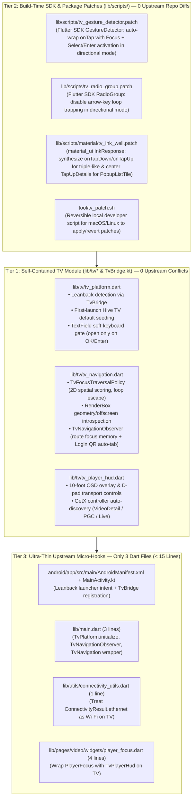

# PiliPlus-LemonTeaV: Three-Tier Decoupled TV Architecture

## 1. Architectural Overview

Earlier TV porting attempts (`PiliPlus-TV`) scattered inline TV modifications across **50+ upstream business files** (converting `GestureDetector` to `InkWell` in 30+ pages, editing `radio_widget.dart`, `slider_dialog.dart`, `storage_pref.dart`, `login/view.dart`, `video/view.dart`, etc.). Every upstream sync risked massive merge conflicts.

**PiliPlus-LemonTeaV** solves this by isolating all Android TV functionality into a **Three-Tier Decoupled TV Control Layer**:

---

## 2. Tier 1: Self-Contained TV Module (`lib/tv/*` & `TvBridge.kt`)

All TV-specific Dart logic resides strictly inside `lib/tv/`, and native Android TV detection resides in `android/app/src/main/kotlin/com/example/piliplus/TvBridge.kt`.

### 2.1 `lib/tv/tv_platform.dart` & `TvBridge.kt`
* **Hardware Detection**: Queries `PackageManager.FEATURE_LEANBACK`, `UiModeManager.currentModeType == Configuration.UI_MODE_TYPE_TELEVISION`, and display/touchscreen heuristics via MethodChannel `com.example.piliplus/tv`.
* **Zero-Touch Default Preferences Seeding**:
  Instead of editing `lib/utils/storage_pref.dart` in 12 places (which causes frequent upstream merge conflicts), `TvPlatform.initialize()` runs right after `GStorage.init()` in `main.dart` and seeds TV-optimal defaults into `GStorage.setting` **once** (using a marker key `tvDefaultsSeededV1` and only for keys not already customized by the user):
  * `SettingBoxKey.horizontalScreen`: `true`
  * `SettingBoxKey.useSideBar`: `true`
  * `SettingBoxKey.enableVerticalExpand`: `false`
  * `SettingBoxKey.defaultFullScreen`: `true`
  * `SettingBoxKey.autoPlayEnable`: `true`
  * `SettingBoxKey.enableShowDanmaku`: `true`
* **Android TV System Keyboard Gate**:
  In Flutter, focusing an `EditableText` (`TextField`) during directional D-pad navigation immediately opens the system soft keyboard, hijacking the screen when a user merely moves focus past a search bar.
  `TvPlatform` intercepts outgoing `SystemChannels.textInput` calls when `TvPlatform.isTv`:
  * `TextInput.show` is suppressed during passive D-pad focus changes;
  * When the user explicitly presses **OK / Select / Enter** on a focused `EditableText` (or when `TvPlatform.allowNextSoftKeyboardShow()` is triggered), `TextInput.show` is allowed through so the native Android TV soft keyboard opens cleanly.

### 2.2 `lib/tv/tv_navigation.dart`
* **Global Directional Navigation Mode**:
  Sets `MediaQueryData.navigationMode = NavigationMode.directional` at the app root. This natively instructs Flutter's `Slider` and Material widgets to use directional focus semantics instead of trapping `Up`/`Down`/`Left`/`Right` arrow keys—eliminating any need to edit `slider_dialog.dart`, `dual_slider_dialog.dart`, or settings pages.
* **Hardened 2D Spatial Traversal (`TvFocusTraversalPolicy`)**:
  * **Directional Projection & Cone Scoring**: Evaluates candidates in the pressed direction (`Up`/`Down`/`Left`/`Right`) with primary-axis distance, cross-axis overlap, and same-container affinity.
  * **RenderBox Geometry & Off-Screen Introspection (Replaces `animated_height.dart` & `app_bar_ani.dart` edits)**:
    `_isEffectivelyFocusable(FocusNode node)` inspects the ancestor `RenderObject` chain:
    1. Rejects any node whose own `RenderBox` or ancestor `RenderBox` has `size.width < 1.0 || size.height < 1.0` (automatically filtering collapsed `AnimatedHeight` / `Align(heightFactor: 0)` widgets without editing `animated_height.dart`);
    2. Rejects any node whose global paint bounds do not intersect the visible screen viewport (automatically filtering slid-away `AppBarAni` / `SlideTransition` bars without editing `app_bar_ani.dart`).
  * **Nested Focus Deduplication & Micro-Button Filtering**:
    1. Prevents double-stopping on both a parent container (`ListTile` / `InkWell`) and its child (`Switch` / `Checkbox` / `Radio`);
    2. Filters tiny secondary card overflow buttons (`29x29` `VideoPopupMenu`) during vertical/horizontal grid traversal so D-pad navigation moves cleanly card-to-card.
  * **Closed-Loop Scroll & Dialog Escape**:
    Allows `Up`/`Down` at the boundary of a scrollable list inside a dialog or page to escape to header/footer action buttons (`取消` / `确定`, `详细` / `快速`) instead of wrapping around in an infinite loop.
  * **Auto-Scroll Into View & Focus Highlight Ring**:
    Calls `Scrollable.ensureVisible` on focus change and renders a high-contrast animated TV focus ring via a non-interactive `OverlayEntry`.
* **`TvNavigationObserver` (Route Focus Memory & Login QR Tab Auto-Switch)**:
  * Saves and restores the last focused node per route when pushing/popping pages or dialogs;
  * Detects when `/loginPage` is pushed on TV and schedules a post-frame callback to switch `Get.find<LoginPageController>().tabController.animateTo(2)` (the `扫码登录` QR Code tab)—requiring **0 edits** to `lib/pages/login/controller.dart` or `lib/pages/login/view.dart`!

### 2.3 `lib/tv/tv_player_hud.dart`
* **Self-Contained 10-Foot Player HUD**:
  Wraps `PlayerFocus` when `TvPlatform.isTv`.
* **Controller Auto-Discovery (Replaces `video/view.dart` & `live_room/view.dart` edits)**:
  Instead of requiring `VideoDetailPageV` and `LiveRoomPage` to pass 10 custom callbacks down into `PlayerFocus`, `TvPlayerHud` inspects `plPlayerController`, `introController` (`UgcIntroController` / `PgcIntroController`), and active GetX controllers directly to provide:
  * **Left / Right**: Seek backward/forward (with hold-to-accelerate scrub preview);
  * **OK / Select**: Toggle play/pause when HUD is hidden, or activate focused HUD control when HUD is visible;
  * **Down / Up / Menu**: Summon the TV OSD control strip (Play/Pause, Danmaku toggle, Episode selector, Quality selector, Playback speed, Aspect ratio / Fit, Like / Coin / Favorite / Triple-like actions);
  * **Back**: Dismiss HUD if visible → exit fullscreen if fullscreen → pop route.

---

## 3. Tier 2: Build-Time SDK & Package Patches (`lib/scripts/`)

PiliPlus already applies 34 patches to `$FLUTTER_ROOT` and `~/.pub-cache/hosted/pub.dev/material_ui-*` via [`lib/scripts/patch.ps1`](../../lib/scripts/patch.ps1). Adding 3 small TV patches to this pipeline fixes widget-level D-pad issues globally with **zero upstream PiliPlus file modifications**:

| Patch File | Target | Problem Solved | Upstream PiliPlus Files Saved from Editing |
| :--- | :--- | :--- | :--- |
| `lib/scripts/tv_gesture_detector.patch` | `$FLUTTER_ROOT/packages/flutter/lib/src/widgets/gesture_detector.dart` | In `NavigationMode.directional`, auto-wraps `GestureDetector(onTap != null)` with a `Focus` node that invokes `onTap()` on `Select`/`Enter`/`GameButtonA` (and triggers soft keyboard permission if wrapping an `EditableText`). | **30+ files** (`mine/view.dart`, `fav_item.dart`, `history_item.dart`, `ugc/view.dart`, `pgc/view.dart`, `audio/view.dart`, `color_select.dart`, `member_card.dart`, etc.) |
| `lib/scripts/tv_radio_group.patch` | `$FLUTTER_ROOT/packages/flutter/lib/src/widgets/radio_group.dart` | Disables `RadioGroup`'s arrow-key (`Up`/`Down`/`Left`/`Right`) shortcut interception when `NavigationMode.directional` is active so D-pad arrows move focus normally instead of trapping focus inside radio lists. | **6+ files** (`radio_widget.dart`, `select_dialog.dart`, `report.dart`, `login/controller.dart`, `display_mode.dart`, etc.) |
| `lib/scripts/material/tv_ink_well.patch` (+ SDK mirror `lib/scripts/tv_ink_well.patch`) | `material_ui/lib/src/ink_well.dart` & `$FLUTTER_ROOT/.../material/ink_well.dart` | 1. Allows `InkResponse` with `onTap == null && onTapDown != null && onTapUp != null` (used by `ActionItem` for hold-to-triple-like) to be focusable in `NavigationMode.directional` and synthesizes tap/long-press on OK key. 2. Synthesizes center-rect `TapUpDetails` when `ActivateIntent` invokes an `InkResponse` with `onTap == null && onTapUp != null` (used by `PopupListTile`). | **4 files** (`action_item.dart`, `ugc/view.dart`, `pgc/view.dart`, `popup_list_tile.dart`) |

### Local Developer Patch Helper (`tool/tv_patch.sh`)
Because CI uses PowerShell (`lib/scripts/patch.ps1`), we also provide `tool/tv_patch.sh` (`apply` / `revert` / `status`) for macOS/Linux local development so patches can be applied or reverted in one command.

---

## 4. Tier 3: Ultra-Thin Upstream Micro-Hooks

Outside of `lib/tv/*`, `lib/scripts/*`, `tool/tv_patch.sh`, `docs/tv/*`, and `.github/workflows/*`, only **5 existing files** in the repository are touched:

1. `android/app/src/main/AndroidManifest.xml` (+ banner resource): Adds `android.software.leanback` (`required="false"`), `android.hardware.touchscreen` (`required="false"`), and `LEANBACK_LAUNCHER` category.
2. `android/app/src/main/kotlin/com/example/piliplus/MainActivity.kt`: Adds 1 line `TvBridge.register(flutterEngine, this)` inside `configureFlutterEngine`.
3. `lib/main.dart`: Adds `await TvPlatform.initialize();`, `if (TvPlatform.isTv) TvNavigationObserver()`, and wraps `MyApp._builder` return value in `TvNavigation(child: child)`.
4. `lib/utils/connectivity_utils.dart`: Updates `isWiFi` to return `true` when `TvPlatform.isTv && results.contains(ConnectivityResult.ethernet)` so all upstream controllers treat wired TV Ethernet as Wi-Fi without renaming `isWiFi`.
5. `lib/pages/video/widgets/player_focus.dart`: Wraps `PlayerFocus.build` with `TvPlayerHud` when `TvPlatform.isTv`.
